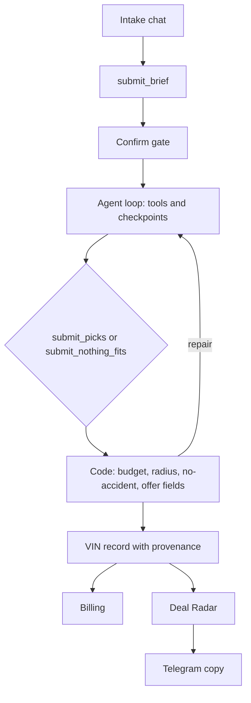

# Lemonless

A US used-car shopper describes what they need. Lemonless searches live listings, checks public records, and returns a buy, negotiate, inspect, or pass — or says nothing fits. Every dollar in the answer comes from code. The model chooses the car and the offer; it does not invent the numbers.

**Live:** [autoflip-umber.vercel.app](https://autoflip-umber.vercel.app/)  
**Evidence:** [/proof](https://autoflip-umber.vercel.app/proof) — the recorded comparison, with a link on each cell. This README does not add a score on top of that page.

Legacy names (`AUTOFLIP_*`, cookie `af_uid`, the GitHub repo, the Vercel host) stay so existing config keeps working. The product name is Lemonless.

## What it does

- **Find** — one chat. The model writes a brief, you confirm it, then it searches and either picks cars or says nothing fits.
- **Check** — a listing URL, pasted text, or a VIN. Price math stays in code. A review step runs when a key is set and the safety checks allow it.
- **Resale** — the same chat shape, ranked by code profit, not by a model-invented margin.
- **Deal Radar** — paid watches. Radar is $100/month for 1 search (up to 300 reviews) and Radar Pro is $250/month for 3 searches (up to 900). Plans do not include report credits. Alerts stay in the app, with an optional Telegram copy.
- **Report** — one credit after a result is delivered. Nothing-fits, errors, and empty searches release the credit.

A missing source never blocks a decision. Unknown accident history and unknown distance are shown as unverified.

## How it works

SERV decides. Code validates, enforces hard constraints, does the math, and keeps the journal.



1. The chat collects the brief (`submit_brief`) and stops until you confirm. It does not search before that.
2. After confirm, the loop calls listing search and public-record tools. Checkpoints let a long run continue on the next request.
3. The loop ends with `submit_picks` or `submit_nothing_fits`.
4. Code rejects a pick that breaks a confirmed rule (budget, a known radius, a no-accident brief when a source reports an accident or a title brand) and sends it back for repair. If nothing clean fits, the finish is `submit_nothing_fits` naming the near misses.
5. Distance is miles from your ZIP to the dealer ZIP or coordinates. When that cannot be computed, the record says unverified.
6. The offer you see is `openingOffer` and `walkAway` from `submit_picks`. The report, Radar, and Telegram read those fields.
7. Each car is stored by VIN with where every field came from. Details: [docs/ARCHITECTURE.md](docs/ARCHITECTURE.md).

## Proof

Open [/proof](https://autoflip-umber.vercel.app/proof). That page is the comparison. It links the runs it measured. A frozen-snapshot harness in `eval/snapshot/` can replay one captured candidate set with verdict features off and on, without a second live search. The paid replay is not part of this commit (`npm run eval:snapshot` records the arms as not run).

## Run it

```bash
npm install
cp .env.example .env.local
npm run dev
```

Open http://localhost:3000. For a local report without Stripe, set `AUTOFLIP_DEV_CREDITS=3` and restart.

```bash
npm run typecheck
npm test
npm run golden
npm run test:e2e
npm run build
```

`npm run eval:serv` and `npm run eval:verdict` call the model and spend credits. They exit without inventing scores when `SERV_API_KEY` is unset.

| Variable | Purpose |
| --- | --- |
| `AUTODEV_API_KEY` | Listing search |
| `SERV_API_KEY` | Model reviews |
| `SERV_MODEL` | Default model id for SERV steps |
| `SERV_BASE_URL` | Default `https://inference-api.openserv.ai/v1` |
| `STRIPE_SECRET_KEY` | Test key (`sk_test_`) |
| `STRIPE_WEBHOOK_SECRET` | Webhook signature |
| `NEXT_PUBLIC_APP_URL` | Checkout return URL |
| `AUTOFLIP_DEV_CREDITS` | Optional local starting balance |
| `UPSTASH_REDIS_REST_URL` / `UPSTASH_REDIS_REST_TOKEN` | Durable store on Vercel |
| `AUTH_SECRET` | Sign-in |
| `AUTH_GOOGLE_ID` / `AUTH_GOOGLE_SECRET` | Google sign-in |
| `NEXT_PUBLIC_FIREBASE_API_KEY` / `NEXT_PUBLIC_FIREBASE_AUTH_DOMAIN` / `NEXT_PUBLIC_FIREBASE_PROJECT_ID` / `NEXT_PUBLIC_FIREBASE_APP_ID` | Email link sign-in. All four, or the option stays hidden. |
| `TELEGRAM_BOT_TOKEN` / `TELEGRAM_BOT_USERNAME` / `TELEGRAM_WEBHOOK_SECRET` | Optional Radar Telegram copy |

Do not commit `.env.local`.

Stripe test card: `4242 4242 4242 4242`. The daily Radar cron is `0 14 * * *` in `vercel.json`. Telegram username: `@autoflip_radar_bot`.

Sign-in is required for Find, Resale, Check, Radar, and the agent API. The only free allotment is 3 Checks per account per UTC month. Find and Resale reserve 1 report credit before the model runs. The gate is `src/server/search-billing-gate.ts`.

Agent API: `POST /api/v1/report` and `POST /api/mcp` with an `af_` key from [/developers](https://autoflip-umber.vercel.app/developers). `full_report` spends 1 credit.
