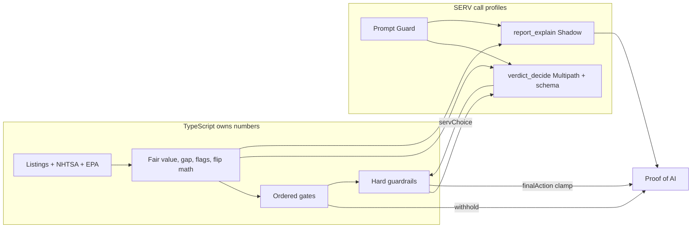

# Lemonless

**Tagline:** Buy smart. Stay lemonless.

**Product:** Lemonless turns a US used-car listing into an explainable **buy / negotiate / pass / needs inspection** decision with the arithmetic shown — or **withholds** a verdict when evidence is insufficient.

**For judges:** The model never touches a number — and every report links to the Proof of AI that proves it.

**Legacy identifiers:** Env vars (`AUTOFLIP_*`), Redis/KV globals, cookie `af_uid`, Stripe lookup keys, schema versions (`autoflip.*.v1`), the GitHub repo name, and the Vercel host still use the legacy `autoflip` / `af_` prefix so existing config and stored data keep working. The Flip **mode** name is unchanged.

**SERV’s role:** OpenServ SERV Reasoning chooses that shopper action from TypeScript-computed facts; TypeScript owns every number, runs ordered gates first, and clamps hard safety rails SERV cannot override.

## For judges (SERV Hackathon Open Track)

Judged mainly from this GitHub repo and a live demo. Consumer UI stays free of hackathon / OpenServ / crypto wording; this README may name SERV.

| Link | What |
| --- | --- |
| [Live demo](https://autoflip-umber.vercel.app/) | Product preview |
| [Sample report](https://autoflip-umber.vercel.app/report/sample) | Labeled fixture report |
| [Eval dashboard `/compare`](https://autoflip-umber.vercel.app/compare) | Standard vs SERV-checked (reads committed results only) |
| [Agents / MCP](https://autoflip-umber.vercel.app/developers) | API key + MCP snippets |
| [Verdict eval status](eval/results/verdict-latest.md) | Measured or **not yet run** — never fabricated |
| [SERV eval results](eval/results/latest.md) | Last committed `eval:serv` run (when present) |
| [Proof of AI example](docs/examples/proof-of-ai-verdict.md) | Redacted verdict + guardrail proof shape |
| [Judge guide](docs/judge-guide.md) | One-page architecture notes |

### Architecture



1. **TS facts** — comps, mileage/history adjustments, fair value, price gap, recall/title/odometer flags (`src/domain/report.ts`).
2. **Ordered gates** — data sufficiency → VIN identity → title/recall/odometer → price vs comps → mandate fit (budget / target profit / repair skill). Insufficient evidence → **WITHHELD** with a concrete refusal reason; SERV is skipped (`src/domain/verdict-gates.ts`).
3. **Hard guardrails** — built from those gates (`src/domain/verdict-guardrails.ts`). Buy is forbidden where listed; title/park-it force `pass`.
4. **SERV decision** — only when gates allow; `verdict_decide` returns `{ verdict, note }` with `verdict ∈ { buy, negotiate, pass, needs_inspection }` (`src/server/serv/profiles.ts`).
5. **Clamp** — TypeScript applies rails, records override reasons, maps to internal `Verdict` (`src/domain/verdict-decide.ts`, wired in `src/server/assemble.ts`).
6. **Explanation** — separate SERV prose, number-audited (`src/domain/audit.ts`). On SERV failure/timeout, the **labeled deterministic fallback** is used.
7. **Proof of AI** — inputs hash, profile checks, ordered gates, `servChoice`, guardrail result, `finalAction` / `finalVerdict` in `proof.toolOutputs.verdictDecision`. Every report UI links to that record under **How this was checked**.

### Task → SERV profile → why

These are **call profiles** (one `runServ(id)` each), not a multi-agent swarm. Kronos / Multipath are model-id suffixes; Shadow is an optional second pass; Prompt Guard and the content filter are request tools/defaults.

| Task | Profile | SERV features used | Why |
| --- | --- | --- | --- |
| Screen untrusted input | `*_guard` | Prompt Guard, content filter | User/seller text is untrusted |
| Extract /find need | `need_extract` | Prompt Guard, strict JSON schema | App consumes structured need; code still validates |
| Apply VIN/listing rules prose | `check_rules` | Prompt Guard, **Kronos**, content filter | Procedural rules; numbers still audited |
| **Choose buy / negotiate / pass / needs_inspection** | `verdict_decide` | Prompt Guard, Shadow, **Multipath**, JSON schema | Branching shopper action; TS clamps rails |
| Explain the report | `report_explain` / `agent_explain` | Prompt Guard, Shadow, `read_computed_facts` | Prose only; cannot change numbers |
| Flip Radar alert vs skip | `flip_judge` | Prompt Guard, Shadow, **Multipath**, JSON schema | Bounded alert/skip from code estimates |
| Flip feasibility prose | `flip_feasibility` | Prompt Guard, **Kronos** | Short rules before flip_judge |
| Personal radar sentence | `personal_alert_review` | Prompt Guard, Shadow | Rewording only |
| Telegram help | `telegram_reply` | Prompt Guard, streaming | Canned fallback if the call fails |

Registry: [`src/server/serv/profiles.ts`](src/server/serv/profiles.ts). Gateway: [`src/server/serv/run.ts`](src/server/serv/run.ts).

### What SERV does NOT do

| Claim | Reality | Code |
| --- | --- | --- |
| Invent fair value, margin, or score | Numbers come from deterministic tools | `src/domain/report.ts`, `flip.ts`, `assumptions.ts` |
| Override salvage / park-it / VIN conflict | Clamp forces `pass` or `needs_inspection` | `src/domain/verdict-guardrails.ts` |
| Write prices into the decision | `auditExplanation` rejects invented `$` / `%` / miles / VINs and buy-language on hard negatives | `src/domain/audit.ts` |
| Run without a recorded proof path | Assemble always records steps + `verdictDecision` | `src/server/assemble.ts` |
| Replace missing Auto.dev / NHTSA data | Missing stays missing | `dataNotes`, source checks |

### Limits (honest)

- Evaluation preview, not a production vehicle-history product. No NMVTIS title API; title brands are listing-text + external links.
- Auto.dev free plan is evaluation-only (monthly call cap in-app).
- Stripe is **test mode** only.
- Without `SERV_API_KEY`, verdicts use the labeled code baseline under the same guardrails.
- `eval:verdict` commits **not yet run** until someone with a real key runs it — see [`eval/results/verdict-latest.md`](eval/results/verdict-latest.md).
- Durable Google / email sign-in (Auth.js) is optional until `AUTH_SECRET` and a provider are set; paid checkout fails closed without them. See [`docs/auth-and-credits.md`](docs/auth-and-credits.md).

## What works

- Home flow: need → directions → listings → full analysis (1 credit). Deal Radar watches do not spend report credits.
- Personal mode: asking vs mileage-and-history fair value. Flip mode: resale range from comparable **asking** prices minus fee/recon assumptions.
- Hard rails + SERV `verdict_decide` + explanation audit on every full report when keyed.
- MCP `deal_radar` / `full_report` and `POST /api/v1/report` with Proof of AI on paid agent responses.

## How to run locally

```bash
npm install
cp .env.example .env.local
# Set AUTODEV_API_KEY and optionally SERV_API_KEY
npm run dev
```

Open http://localhost:3000. For a local full report without Stripe, set `AUTOFLIP_DEV_CREDITS=3` and restart.

```bash
npm run typecheck
npm test
npm run build
npm run eval:serv      # requires SERV_API_KEY; exits immediately without it
npm run eval:verdict   # verdict_decide accuracy; writes not-yet-run stub without a key
```

Stripe test card: `4242 4242 4242 4242`. Forward webhooks to `POST /api/stripe/webhook`.

## Environment

| Variable | Purpose |
| --- | --- |
| `AUTODEV_API_KEY` | Auto.dev listings |
| `SERV_API_KEY` | OpenServ SERV Reasoning |
| `SERV_MODEL` | Default `gpt-5.4-mini` |
| `SERV_BASE_URL` | Default `https://inference-api.openserv.ai/v1` |
| `STRIPE_SECRET_KEY` | Must start with `sk_test_` |
| `STRIPE_WEBHOOK_SECRET` | Webhook signature |
| `NEXT_PUBLIC_APP_URL` | Checkout return URL |
| `AUTOFLIP_DEV_CREDITS` | Optional local starting balance |
| `UPSTASH_REDIS_REST_URL` / `UPSTASH_REDIS_REST_TOKEN` | Durable KV on Vercel |
| `AUTH_SECRET` | Auth.js secret (required for sign-in) |
| `AUTH_GOOGLE_ID` / `AUTH_GOOGLE_SECRET` | Google OAuth |
| `EMAIL_SERVER` / `EMAIL_FROM` | Passwordless email (or `AUTH_EMAIL_MODE=test` for stubs) |

Do not commit `.env.local`.

## Deterministic rules (short)

Constants: `src/domain/assumptions.ts` (copied onto each report).

- Comparables: same make/model with price+miles; trim preferred; year window then widen; &lt;3 → needs inspection.
- Mileage: 0.5% of median comp price per 1,000 miles difference.
- History: accident / fleet / multi-owner haircuts; **missing accident history is not clean** (`unknownHistoryHaircut`).
- Personal gap bands: under −8% buy band, through +6% negotiate, through +15% pass-on-price, above that pass; park-it / title brand force pass; VIN conflict → needs inspection.
- Flip: 25th/75th asking resale, 3% sell friction, fee + recon assumptions; park-it forces pass.

## Agent API

`GET /api/mcp` · `POST /api/mcp` · `POST /api/v1/report` · agent card at [`/.well-known/agent.json`](https://autoflip-umber.vercel.app/.well-known/agent.json). Create a key on [`/developers`](https://autoflip-umber.vercel.app/developers). `full_report` spends 1 credit. Responses include `proof`.

```bash
# List MCP tools
curl -s https://autoflip-umber.vercel.app/api/mcp \
  -H 'content-type: application/json' \
  -H 'authorization: Bearer af_YOUR_KEY' \
  -d '{"jsonrpc":"2.0","id":1,"method":"tools/list"}'

# Free Deal Radar
curl -s https://autoflip-umber.vercel.app/api/mcp \
  -H 'content-type: application/json' \
  -H 'authorization: Bearer af_YOUR_KEY' \
  -d '{"jsonrpc":"2.0","id":2,"method":"tools/call","params":{"name":"deal_radar","arguments":{"make":"Toyota","model":"Camry","mode":"personal","zip":"78701"}}}'

# Full report via API key (1 credit)
curl -s https://autoflip-umber.vercel.app/api/v1/report \
  -H 'content-type: application/json' \
  -H 'authorization: Bearer af_YOUR_KEY' \
  -H 'idempotency-key: demo-1' \
  -d '{"mode":"personal","vin":"VIN","zip":"78701"}'
```

## Deal Radar

Saved searches run on a schedule without spending report credits. Personal watches use market-band prefilters (including suspiciously cheap rejection). Broad flip watches rank comps in-scan; SERV `flip_judge` may annotate but cannot suppress a code-ranked alert. Details: `src/server/radar-cycle.ts`, `src/domain/radar-watch.ts`.

## Deploy

Next.js on Vercel (`npm run build`). Secrets only in the host env. With Auth.js configured, credits and reports belong to the signed-in account in Upstash/KV; without auth env, search still works and paid checkout stays locked. Details: [`docs/auth-and-credits.md`](docs/auth-and-credits.md).
