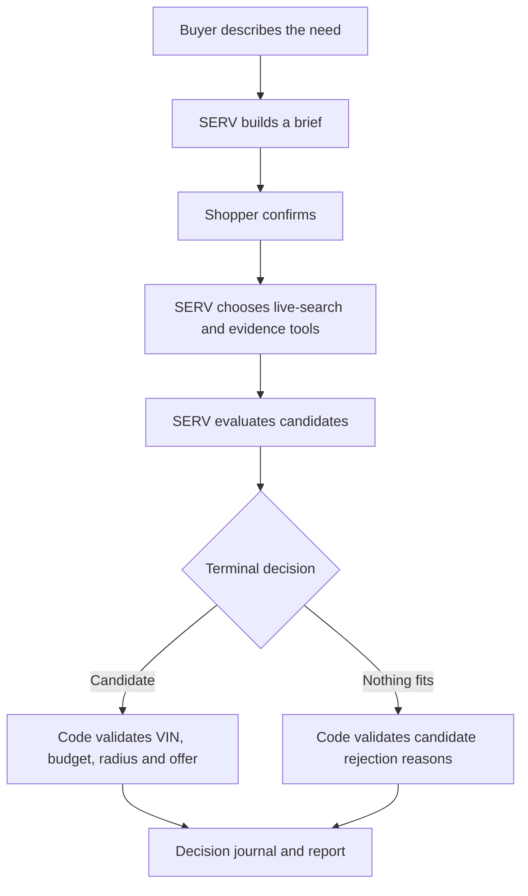

# Lemonless

**An AI agent that helps people buy, evaluate, and resell used cars — with OpenServ SERV as its reasoning layer.** Lemonless turns a buyer's brief into live inventory searches, vehicle-data checks, a specific recommendation, and a structured offer. It can also explain when no candidate fits.

[**Live app**](https://autoflip-umber.vercel.app/) · [**Proof**](https://autoflip-umber.vercel.app/proof) · [Architecture](docs/ARCHITECTURE.md) · [Agent API](https://autoflip-umber.vercel.app/developers) · [OpenAPI](https://autoflip-umber.vercel.app/openapi.json)

[](https://github.com/aspekt19/autoflip/actions/workflows/ci.yml)

Built for **OpenServ SERV Hackathon Edition 02 — Open Track**.

## Try it in a minute

1. Open the [live app](https://autoflip-umber.vercel.app/) and sign in.
2. Go to [Find](https://autoflip-umber.vercel.app/find), describe the car you need, and confirm SERV's proposed brief.
3. Watch SERV search current dealer inventory, call vehicle-data tools, and return a shortlist or a reasoned no-fit decision.
4. Open [Proof](https://autoflip-umber.vercel.app/proof) to inspect the recorded Denver case and compare the Find workflow with the Gemini Chat answer.

Example request used in the published case:

> I'm in Denver 80202, budget $25k all-in, need an AWD SUV for mountain winters and a 40-mile daily commute. Two kids, so safety matters most. Under 100k miles, no accident or salvage history, low fuel cost. Within 75 miles. Which one should I buy and what should I offer?

Find requires a verified account and an available report credit to start a search; the credit is committed only when a qualifying result is delivered. The published Proof run was isolated and did not charge a customer credit.

## Try Lemonless

- **Find** — describe the vehicle you need in natural language. SERV clarifies the brief, asks you to confirm it, searches live listings, checks available evidence, and returns a shortlist or a reasoned nothing-fits result.
- **Check** — evaluate a VIN, listing URL, or pasted listing. Code calculates price context; the agent reviews available VIN, safety, recall, complaint, fuel-economy, and market evidence.
- **Resale** — search within a budget and assess potential flips using code-calculated costs and risk-adjusted profit. A negative-profit candidate cannot become a buy recommendation.
- **Deal Radar** — save vehicle watches and receive in-app alerts when matching inventory changes. Telegram can send an optional copy.

The human product uses verified sign-in. Find and Resale reserve one report credit before the agent runs and commit it only when a qualifying result is delivered. Check includes three free VIN-scoped checks per verified account per UTC month, then uses one report credit.

## Why SERV matters

Lemonless is not a chat wrapper around a car-search API. **SERV reasons over the shopper's intent and the evidence returned by tools. TypeScript owns deterministic facts, arithmetic, and hard limits.**



- **SERV** interprets the request, chooses search filters and evidence tools, decides which candidates deserve consideration, and explains its recommendation.
- **Code** owns listing identifiers, source provenance, VIN allow-lists, distance calculations, price arithmetic, structured offers, resale profit, credit settlement, and safety gates.
- **Hard constraints stay hard.** A candidate outside a known radius, above the confirmed budget, or in conflict with a shopper's explicit constraint is rejected or sent back for repair.
- **No invented winner.** A nothing-fits result is a valid terminal decision. The agent must explain the overall outcome and provide candidate-specific reasons for vehicles it considered and rejected.
- **Unknown is not silently converted into a pass.** The UI and decision journal preserve which sources were actually checked and what each source returned.

Every delivered run can include a decision journal that separates SERV calls, tool calls, code-enforced checks, and the evidence behind the result. See [Architecture](docs/ARCHITECTURE.md) and [Where SERV runs](https://autoflip-umber.vercel.app/where-serv-runs).

## Proof: one real buyer request

The public [Proof page](https://autoflip-umber.vercel.app/proof) presents one recorded comparison between Gemini Chat and Lemonless Find using the same request:

> I'm in Denver 80202, budget $25k all-in, need an AWD SUV for mountain winters and a 40-mile daily commute. Two kids, so safety matters most. Under 100k miles, no accident or salvage history, low fuel cost. Within 75 miles. Which one should I buy and what should I offer?

**Gemini Chat · Auto mode** gave model-level advice: it recommended 2022–2023 Subaru Forester and 2023 Mazda CX-5 model families and suggested opening at $24,200 out the door. The original [Gemini conversation](https://share.gemini.google/zr44XVFu8UNW) is linked from Proof. Auto mode selected the underlying model; this README does not assign it a specific model version.

**Lemonless Find · SERV** searched live inventory and selected a specific **2021 Subaru Forester Premium AWD**:

| Field | Recorded result |
|---|---|
| VIN | `JF2SKAJC5MH423912` |
| Asking price | $20,197 |
| Mileage | 89,215 miles |
| Location | Longmont, Colorado |
| Distance | About 28 miles from ZIP 80202 |
| Recommendation | Needs inspection; medium confidence |
| Opening offer | $19,000 before taxes and fees |
| Vehicle-price walk-away | $20,000 |
| Shopper's all-in ceiling | $25,000 |

The run requested VIN decoding, vehicle-safety and recall/complaint data, fuel-economy evidence, and local asking-price comparisons.

### What Find adds in this case

Gemini's answer was useful for choosing model families and planning a Denver-area negotiation. Find connected the same buyer brief to a specific local candidate and a traceable evidence trail:

| Buyer question | Gemini Chat · Auto | Lemonless Find · SERV |
|---|---|---|
| What should I look for? | Recommended Forester and CX-5 model-year/trim families. | Selected a live 2021 Forester Premium AWD listing with VIN, mileage, price and location. |
| Does this exact car match? | No individual listing or VIN was named. | Decoded the VIN and returned the vehicle configuration. |
| What about safety and running costs? | Gave model-level safety and MPG guidance. | Retrieved the selected vehicle's official vehicle safety lookup and an estimated 29 MPG combined / $1,670 annual fuel cost for the closest configuration. |
| Is the price grounded locally? | Gave approximate model-family price ranges. | Compared nearby 2019–2021 Forester asking prices and returned a $19,797 median. |
| What should I offer? | Suggested $24,200 out the door as an opening offer. | Suggested $19,000 before taxes and fees, with a $20,000 vehicle-price walk-away point, tied to the selected listing and local comparables. |
| How safe is the recommendation? | Included a useful pre-buy checklist. | Returned “needs inspection” at medium confidence and called for an itemized OTD quote and physical checks. |

The difference is workflow depth: Find takes the buyer from a natural-language brief to a specific vehicle, vehicle-level evidence, local price context and a structured next step. It does not claim to replace a vehicle-history report or an in-person inspection, and the final dealer OTD amount must still be confirmed.

The offer fields are explicit structured values, not numbers inferred from prose. The result recommends an inspection and an itemized out-the-door quote before purchase; it is not an instruction to buy immediately.

**Run record:** 13 November 2026, 20:29:50 UTC · 47.5 seconds · 8 SERV calls · 13 tool calls · 12 tool rounds · 88,084 reported tokens. Find ran through the same server-side function used by `/api/find/chat`, with isolated in-memory state. No customer credit was charged and no production data was changed.

**Comparison method:** The Gemini Chat · Auto answer was captured manually from the shared Gemini conversation because an automated Gemini API call was unavailable in the test environment. Lemonless Find was run separately through the same server-side workflow used by `/api/find/chat` and completed successfully. The two systems were not invoked through one shared API harness.

This is one case study, not a statistically representative benchmark and not a claim that Find always selects the best vehicle. The full captured Gemini answer, Find reasoning, comparison, and test disclosures are on [/proof](https://autoflip-umber.vercel.app/proof).

## External AI-agent access and payments

Agents can discover Lemonless through:

- [Agent card](https://autoflip-umber.vercel.app/.well-known/agent.json)
- [OpenAPI](https://autoflip-umber.vercel.app/openapi.json)
- [llms.txt](https://autoflip-umber.vercel.app/llms.txt)
- The free MCP discovery tool `get_payment_info`

Lemonless implements **x402 v2 exact payments in USDC on Base Mainnet**. Paid access is enabled when the Coinbase CDP facilitator credentials are configured in the deployment environment.

| Agent action | Endpoint | Price |
|---|---|---:|
| Register an autonomous agent and receive an `af_` key | `POST /api/agents/register` | $0.01 USDC |
| Run one direct vehicle report | `POST /api/v1/report` | $3.00 USDC |
| Buy 3 report credits | `POST /api/agents/billing/credits` · `pack_3` | $9 USDC |
| Buy 10 report credits | Same endpoint · `pack_10` | $25 USDC |
| Radar · 1 saved watch / up to 300 reviews | `POST /api/agents/billing/plans` · `radar` | $100 USDC / 30 days |
| Radar Pro · 3 saved watches / up to 900 reviews | Same endpoint · `radar_pro` | $250 USDC / 30 days |

Payment network: `eip155:8453`. Token: Base USDC at `0x833589fCD6eDb6E08f4c7C32D4f71b54bdA02913`. Scheme: `exact`. The published treasury is:

```
0x250aC40Ab38E4f023c33C1c3DFD0Cd07357Fbf79
```

The initial 402 response advertises the amount and machine-readable Bazaar input/output schema. Agents send the signed payload in `PAYMENT-SIGNATURE`; successful settlement returns `PAYMENT-RESPONSE`. Registration binds an `af_` key to the payer wallet. The key is returned once and must be stored securely by the agent. Credit packs and Radar plans require that key; Radar plans are prepaid for 30 days and do not auto-renew.

**Operational configuration:** x402 requires persistent Upstash storage (`UPSTASH_REDIS_REST_URL` and `UPSTASH_REDIS_REST_TOKEN`) as well as `CDP_API_KEY_ID` and `CDP_API_KEY_SECRET`. Current readiness is exposed by `GET /api/agents/payment-info`. The receiving wallet's private key is not stored in the application. Human browser checkout is separate and remains in **Stripe test mode**.

## Agent API

Create an API key from [Developers](https://autoflip-umber.vercel.app/developers) or use the paid x402 registration endpoint. Send `Authorization: Bearer af_…` on REST and MCP requests.

- MCP: `POST /api/mcp`
- REST: `/api/v1/check`, `/api/v1/find`, `/api/v1/resale`, `/api/v1/radar/*`, `/api/v1/report`
- Payments: `GET /api/agents/payment-info`, `POST /api/agents/register`, `POST /api/agents/billing/credits`, `POST /api/agents/billing/plans`
- Transparency: [Proof](https://autoflip-umber.vercel.app/proof) · [Verify](https://autoflip-umber.vercel.app/verify) · [Where SERV runs](https://autoflip-umber.vercel.app/where-serv-runs)

## Run locally

Requires Node.js 22.

```bash
npm ci
cp .env.example .env.local
npm run dev
```

For a local report without Stripe, set `AUTOFLIP_DEV_CREDITS=3` in `.env.local` and restart.

Core checks:

```bash
npm run typecheck
npm test
npm run golden
npm run test:e2e
npm run build
```

Model and provider-backed evaluations can make paid requests. Read their explicit opt-in gates before running them.

### Environment variables

| Variable | Purpose |
|---|---|
| `AUTODEV_API_KEY` | Live listing search |
| `SERV_API_KEY` | SERV inference |
| `SERV_MODEL` / `SERV_BASE_URL` | Optional model and endpoint overrides |
| `UPSTASH_REDIS_REST_URL` / `UPSTASH_REDIS_REST_TOKEN` | Durable production storage |
| `AUTH_SECRET`, `AUTH_GOOGLE_ID`, `AUTH_GOOGLE_SECRET` | Auth.js and Google sign-in |
| `NEXT_PUBLIC_FIREBASE_*` | Firebase email-link sign-in |
| `STRIPE_SECRET_KEY` / `STRIPE_WEBHOOK_SECRET` | Human checkout; test keys only |
| `CDP_API_KEY_ID` / `CDP_API_KEY_SECRET` | Coinbase CDP facilitator for x402 |
| `X402_PAY_TO_ADDRESS` | Optional USDC receiver override |
| `X402_FACILITATOR_URL` | Optional facilitator URL override |

Never commit `.env.local` or facilitator credentials.

## Release notes

- Stripe remains in **test mode**. The test card is `4242 4242 4242 4242`; purchases are not real revenue.
- External-agent x402 payments use Base USDC and are separate from the human Stripe checkout.
- Legacy repository, Vercel, cookie, and `AUTOFLIP_*` environment names remain for compatibility. The product name is **Lemonless**.
- The daily Deal Radar cron is configured in `vercel.json`.
